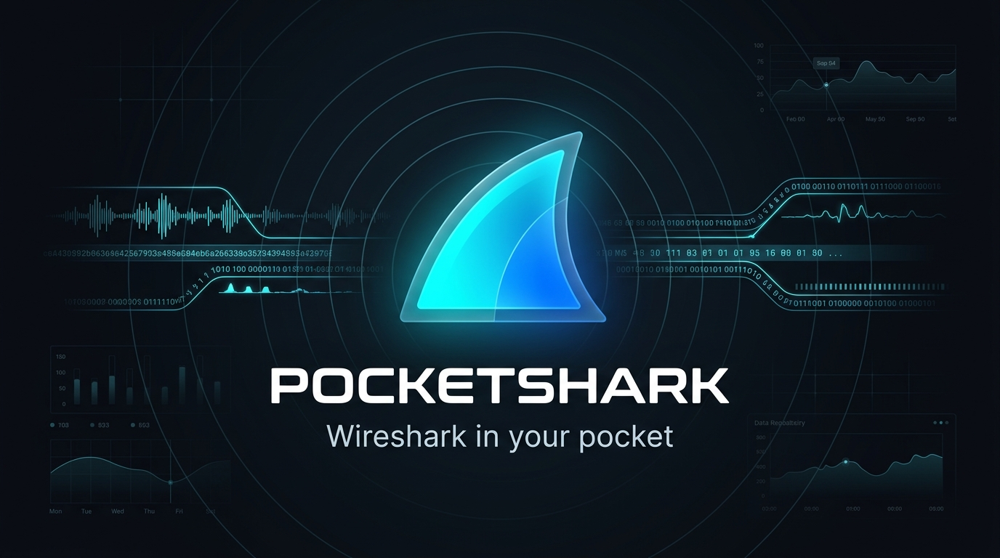
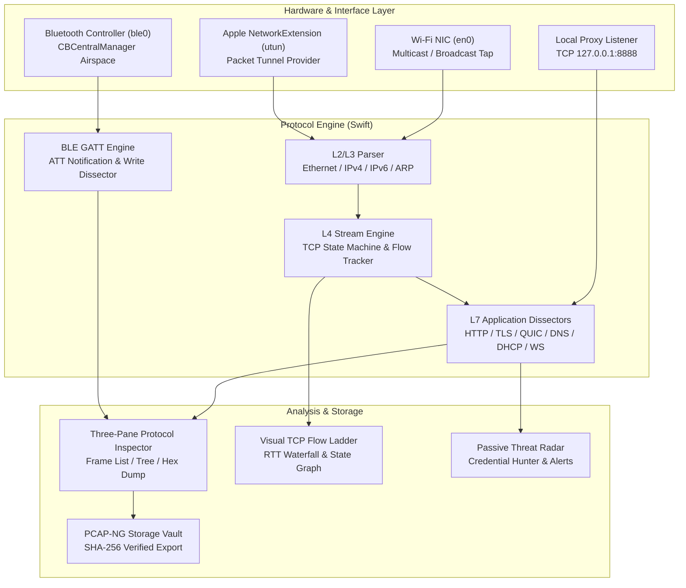

# PocketShark

<p align="center">
  
</p>

<p align="center">
  <strong>Full-Spectrum Mobile Network Analyzer & Airspace Sniffer for iOS & macOS</strong>
</p>

<p align="center">
  <a href="#features">Features</a> •
  <a href="#architecture">Architecture</a> •
  <a href="#quick-start">Quick Start</a> •
  <a href="#non-root-capture">Non-Root Capture</a> •
  <a href="#building-from-source">Build</a> •
  <a href="#license">License</a>
</p>

---

## Overview

**PocketShark** brings deep packet inspection, promiscuous Wi-Fi discovery, and Bluetooth Low Energy (BLE) airspace forensics directly to mobile and desktop environments. Engineered in pure Swift, PocketShark combines low-level socket interception with a high-performance protocol dissection engine and a native SwiftUI interface.

---

## Key Features

### 📡 Multi-Interface Promiscuous Capture
- **Wi-Fi & LAN Discovery:** Native multicast listener capturing mDNS (5353), SSDP (1900), LLMNR (5355), and NetBIOS (137/138).
- **CoreBluetooth Airspace Sniffer:** Live over-the-air monitoring of BLE advertising frames, Apple Continuity (AirPods, AirTags), Google Fast Pair, and Windows SwiftPair beacons.
- **Bidirectional GATT/ATT Dissector:** Dissects Attribute Protocol (ATT) opcodes including notifications (`0x1B`), write commands (`0x12`/`0x52`), and read responses (`0x0A`).
- **Zero Synthetic Injection:** Live hardware mode captures strictly genuine physical traffic from device controllers.

### 🛡️ Non-Root Apple NetworkExtension Tunnel
- Captures 100% of on-device IPv4 and IPv6 traffic without jailbreak or root privileges.
- Built-in `.mobileconfig` XML profile generator for one-tap system profile installation via iOS Settings.
- Transparent local loopback proxy listener for full L7 HTTP/TLS flow visibility.

### 🔬 Protocol Dissectors
- **Transport & Web:** TCP, UDP, HTTP/1.1, HTTP/2, TLS 1.3 ClientHello/ServerHello SNI, WebSocket frame decode, QUIC Initial/Handshake.
- **Network Services:** DNS (A, AAAA, PTR queries/responses), DHCPv4 & DHCPv6 state machine.
- **Visual Flow Ladder:** Real-time TCP conversational state reconstruction with bidirectional sequence/ACK watermarks and round-trip time (RTT) tracking.

### 🔒 Security Hunter & Offline Intelligence
- **Passive Threat Detection:** Rule-based heuristic analysis flagging unencrypted basic authentication, cleartext credentials, exposed JWTs, and MITRE ATT&CK vectors.
- **Offline GeoIP & ASN:** Zero-network-call IP geolocation database mapping public autonomous systems directly on device.
- **Biometric Vault:** Hardware-backed Face ID and Touch ID lock guarding exported captures and case logs.
- **RFC-Compliant PCAP-NG:** Cryptographic SHA-256 chain of custody ensuring forensic integrity.

---

## Architecture



---

## Quick Start

### macOS
1. Download the latest `PocketShark.app` from the Releases tab or your local build.
2. Drag `PocketShark.app` to your `/Applications` directory.
3. Launch the application, select an interface (`en0` or `All Interfaces`), and click **Capture**.

### iOS (Sideloading)
1. Download `PocketShark.ipa` from the repository releases.
2. Sign and deploy the IPA using your preferred sideloading tool:
   - **TrollStore** (JIT & entitlement support)
   - **AltStore** or **SideStore**
   - **Sideloadly**
3. Open PocketShark, navigate to **Vault & Radios**, and tap **Export VPN Profile**.
4. Open **iOS Settings → General → VPN & Device Management** and approve the profile for non-root full-device capture.

---

## Command Line Interface (CLI)

Build and run the standalone command-line forensics engine:

```bash
# Clone the repository
git clone https://github.com/Shashi552/PocketShark.git
cd PocketShark

# Build CLI binary
swift build -c release --product PocketSharkCLI

# Run diagnostic hardware capture
./.build/release/PocketSharkCLI capture --interface en0 --duration 10
```

---

## Project Structure

```
PocketShark/
├── .github/
│   └── workflows/
│       └── build-ipa.yml       # Automated iOS arm64 IPA build workflow
├── Assets/
│   ├── banner.jpg             # High-res GitHub repository hero banner
│   ├── AppIcon.png            # 1024x1024 Retina application icon
│   └── PocketShark.icns       # macOS icon bundle
├── Sources/
│   ├── SharkMobileCore/       # Core capture, dissection, and UI engine
│   │   ├── RealCaptureEngine.swift
│   │   ├── CaptureEngine.swift
│   │   ├── Dissectors.swift
│   │   ├── TunnelManager.swift
│   │   ├── SharkViews.swift
│   │   └── ...
│   └── SharkMobileCLI/        # Standalone terminal diagnostics
└── Package.swift
```

---

## Non-Root Capture Details

PocketShark utilizes Apple's official `NetworkExtension` APIs (`NEPacketTunnelProvider` and `NETunnelProviderManager`). When the tunnel configuration is activated:

1. iOS routes device IP packets through a virtual interface (`utun0`).
2. The packet tunnel provider receives raw IP packets and passes them directly to `PacketTunnelBridge`.
3. PocketShark parses headers, extracts protocol metadata, and presents real-time packet telemetry without requiring device jailbreak.

---

## License

This project is licensed under the MIT License. See the [LICENSE](LICENSE) file for details.
